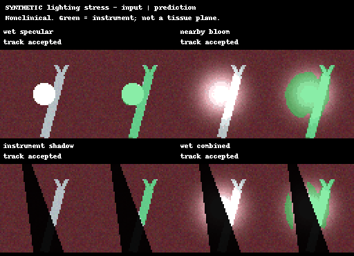

# surgical video test

A small PyTorch test project: segment some toy instruments, add motion, then see what breaks when the view gets bad. The web page replays the actual model outputs.

**Nonclinical educational prototype.** No surgical guidance or automation, tissue-plane detection, real-fluid validation, or claims about Andromeda Surgical's internal technology. All bundled example images and replay results are synthetic. Bright glare and bloom can still cause confidently accepted errors.

## try it

[Private web demo](https://surgical-perception-lab-sahil.mightycocoa30.chatgpt.site) · [Baseline documentation](ml/README.md) · [Milestone 2 method and commands](ml/MILESTONE2.md)



The web app compares five segmenters and three temporal modes over 11 scenarios, including wet-surface glare, nearby overexposure, instrument shadows, opaque fluid, and recovery. It plays recorded inference; no model runs in the browser. The clean target overlay makes errors inspectable.

## Run the Python project

Python 3.10–3.11 is recommended. From the repository root:

```bash
python3 -m venv .venv
source .venv/bin/activate
python -m pip install -e 'ml[dev]'
cd ml
python -m pytest -q
python -m surgtrack.cli synthetic --out demo/data
python -m surgtrack.cli train --data demo/data --out demo/run --epochs 12
python -m surgtrack.cli evaluate --data demo/data --checkpoint demo/run/best.pt --out demo/evaluation.json
```

Run milestone 2 with sparse labels and cycle ablations:

```bash
python -m surgtrack.cli synthetic --out milestone2/data --seed 29 --frames 20
python -m surgtrack.milestone2 --data milestone2/data --out milestone2/run --seeds 7 11 --motion-steps 100 --steps 160
```

Training outputs are ignored by Git. `examples/` preserves the recorded protocol, comparisons, and animations. The full original run, including checkpoints, is bundled in `web/assets/project.zip`. Extract that archive into a separate directory to inspect its artifacts without overwriting a new experiment.

## Run the web app

From the repository root:

```bash
python3 -m http.server 8732 --bind 127.0.0.1 --directory web
```

Open <http://127.0.0.1:8732>. No build step is needed. Playback supports scenario/model/mode selection, scrubbing, opacity, and target overlays. It starts paused when reduced motion is requested.

## what this is trying

Milestone 1 uses a tiny U-Net-style binary segmenter, simple probability smoothing, and an uncalibrated reliability gate. Milestone 2 is an original small adaptation inspired by [Zhao et al., MICCAI 2020](https://arxiv.org/abs/2007.02501): learned joint frame-label propagation plus intermediate-flow compensation with a cycle-learning ablation. It is **not a faithful reproduction** of the paper's pretrained architecture or published results.

Motion training reads only training RGB. Sparse segmenters can access only selected training masks; tests poison withheld masks to detect accidental reads. Checkpoints are selected on validation Dice, and sequence boundaries reset tracking. Two seeds and equal segmentation-update budgets are recorded; motion methods consume additional compute. Simulated lighting effects are not physical fluid/tissue models, and instrument masks cannot supervise safe dissection planes.

Real EndoVis access, terms, and conversion instructions are in the baseline documentation. No EndoVis data is redistributed or used in the bundled synthetic results. The segmenter has a verified ONNX export path; the full temporal pipeline remains Python/PyTorch.

## tests

The local suite contains 15 passing tests covering flow direction, differentiable splatting, support propagation, cycle gradients, mask-access guards, tracking resets, data leakage, and baseline behavior. GitHub Actions runs this test suite on CPU.
